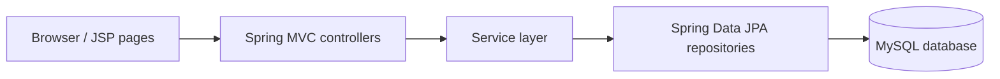

# TV Show Rating System

A full-stack TV show catalog and rating application built with **Java 17, Spring Boot, Spring MVC, JSP, and MySQL**. Users can register, log in, browse shows, add ratings, and post show-related messages.

## Screenshot


[Watch the demo video stored in this repository](images/Tv%20show%20Demo.mp4)

*The video is a repository asset, not a hosted live demo.*

## Features

- User registration and login using server-side sessions
- Browse, create, edit, and delete TV shows
- View show details and average ratings
- Submit ratings and show-related chat messages
- JSP views, custom CSS, and a dark-mode interface

## Technology

- Java 17 and Spring Boot 3.0.6
- Spring MVC, Spring Data JPA / Hibernate, JSP, JSTL
- MySQL
- Maven and Bootstrap

## Architecture



## Local installation

1. Install **JDK 17**, **MySQL**, and Maven (or use the included Maven wrapper).
2. Create a database named `show_schema`.
3. Update `src/main/resources/application.properties` with your **local** MySQL username and password. The repository currently contains example `root` credentials; replace them for your environment and avoid committing real credentials.
4. Run:

   ```bash
   ./mvnw spring-boot:run
   ```

   On Windows, use `mvnw.cmd spring-boot:run`.

5. Open [http://localhost:8080/](http://localhost:8080/) and use the registration/login pages.

## Application routes

This is primarily a **server-rendered MVC application**, not a documented JSON REST API. The following routes return JSP views or redirects.

| Method | Path | Purpose |
| --- | --- | --- |
| GET | `/` | Home page |
| GET | `/register` | Registration form |
| POST | `/register` | Register an account |
| GET | `/login` | Login form |
| POST | `/login` | Submit login |
| GET | `/shows` | Show dashboard (session required) |
| GET | `/shows/{id}` | Show details and ratings |
| GET | `/shows/new` | Create-show form |
| POST | `/shows/new` | Submit new show |
| POST | `/rating/new` | Submit a rating |
| POST | `/shows/messages/new` | Submit a show message |

For example, after signing in through the browser, visit `http://localhost:8080/shows` to see the dashboard.

## Testing

Run `./mvnw test`. The project includes a basic application context test; additional controller, service, and database integration tests are recommended.

## Future improvements

- Replace hardcoded example database credentials with environment variables.
- Add consistent authorization checks for all write endpoints.
- Improve validation and error handling for ratings and messages.
- Add automated controller and service tests.
- Publish a hosted demo when deployment is available.
